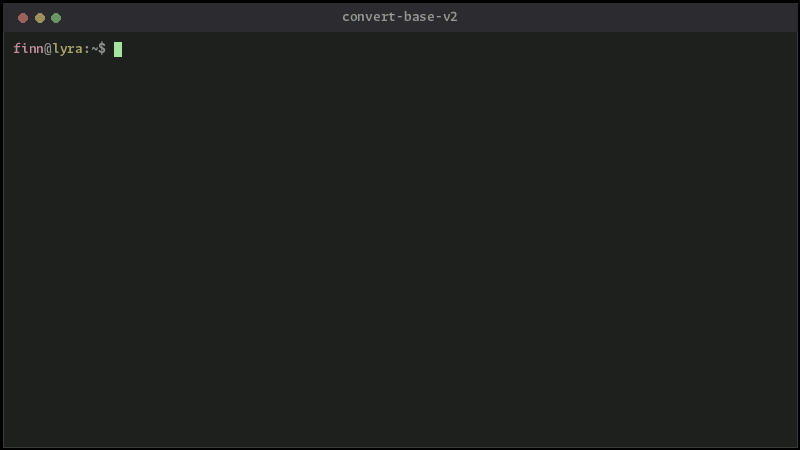

<!-- markdownlint-disable MD007 -- Unordered list indentation -->
<!-- markdownlint-disable MD010 -- No hard tabs -->
<!-- markdownlint-disable MD033 -- No inline html -->
<!-- markdownlint-disable MD055 -- Table pipe style [Expected: leading_and_trailing; Actual: leading_only; Missing trailing pipe] -->
<!-- markdownlint-disable MD041 -- First line in a file should be a top-level heading -->

  

<!-- TOC ignore:true -->
# convert-base-v2

**Convert any number of any size between any two bases, and binary to text in far more bases than usual.**

**[Try it in your browser](https://jim-collier.github.io/convert-base-v2/)**

<table>
	<tr>
		<td>Convert a number of any size between any two bases. Negatives and fractions work too.</td>
		<td>Encode and decode binary as text, streaming, in far more bases than tools like <code>base64</code> have. Decoding is faster than theirs, and encoding is close.</td>
		<td>A single, fast, cross-platform static binary. The same conversion core is also an Apache-licensed Go package and a WebAssembly module, so you can build it into your own program or web page.</td>
	</tr>
</table>

<!-- TOC ignore:true -->
## Table of contents

<!-- TOC -->

- [Features](#features)
- [Try it online](#try-it-online)
- [Installation](#installation)
- [Usage](#usage)
- [Configuration](#configuration)
- [Use it in your own code](#use-it-in-your-own-code)
- [Why convert a number to a large base](#why-convert-a-number-to-a-large-base)
- [When to use something else](#when-to-use-something-else)
- [Speed](#speed)
- [Third-party binary codecs, built in](#third-party-binary-codecs-built-in)
- [List of predefined bases](#list-of-predefined-bases)
- [How to design a numeric base](#how-to-design-a-numeric-base)
- [Set up a development environment](#set-up-a-development-environment)
- [Why the -v2?](#why-the--v2)
- [Support convert-base-v2](#support-convert-base-v2)
- [Legal stuff](#legal-stuff)

<!-- /TOC -->

## Features

- **Any number, any base**: Convert a value of any size to or from any base. More than 60 bases are built in, from base 10, 16, and RFC 4648 base 32 and 64 up to base 65536.

- **Bring your own alphabet**: Define a base on the spot by listing its symbols. For example, "`a 0 c X 🫪 だ`" is a perfectly good base 6.

- **Negatives and fractions**: Both work in nearly every base. Even bases meant only for binary encoding can be pressed into positional use. If the usual `-` and `.` markers clash with a base's own symbols, you can set your own. Fractions are rounded to about the input's own precision. `--precision N` sets a fixed number of digits.

- **Text files as numbers**: Some bases include tab, newline, and return as digits, so a whole text file converts as one number. Those digits can be typed by name, such as `LF` after a marker character. See [Usage](#usage).

- **Binary to text, in many more bases than usual**: Encode or decode raw binary in every power-of-two base (2 through 2048, plus 32768 and 65536) and the standard chunked codecs base45, Ascii85, Z85, and base91. That covers everything `basenc` does except its LSB-first bit string and base 58, at comparable speed, plus bases `basenc` never heard of. Bases with no byte-exact mapping are refused in binary mode, and `--list` shows which ones qualify.

	- To re-encode straight between two text bases as bytes (hex to base 64, say), add `--binary`. Without it, two power-of-two text bases convert as a plain number, which drops leading zeros; a note on stderr points this out, and `--number` silences it.

- **Fast on huge numbers**: A million-digit number converts in about a third of a second. The textbook method takes almost 2 minutes. See [Large numbers](speed.md#large-numbers).

- **Reads from anywhere**: Takes input from the command line or from `stdin`, so it drops into a pipe.

- **One portable binary**: Cross-platform Go, no runtime or dependencies to install.

- **Use it from code**: The same core is a Go package and a WebAssembly module, under the Apache 2.0 license. See [Use it in your own code](#use-it-in-your-own-code).

- **Try it without installing**: The [browser version](https://jim-collier.github.io/convert-base-v2/) runs offline in your tab.

## Try it online

**[Open the converter in your browser](https://jim-collier.github.io/convert-base-v2/)**. Nothing to install, nothing to sign up for.

It runs the real conversion core, compiled to WebAssembly, inside your own browser tab. Every built-in base listed below works, including the large Unicode ones.

*Note: Nothing you type is sent anywhere. Your browser downloads the page and the WASM module once, then does all the work locally - disconnect from the network and it keeps converting. No cookies, beacons, tracking, fingerprinting, analytics, or captchas that have you wondering if you are really a human.*

## Installation

Grab a package or installer for Linux, Windows, macOS, or FreeBSD from the [Releases page](https://github.com/jim-collier/convert-base-v2/releases). Or on Linux, macOS, FreeBSD, and WSL, install the newest stable release with one line:

~~~bash
bash <(curl -fsSL https://raw.githubusercontent.com/jim-collier/convert-base-v2/main/install.bash)
~~~

[install.md](install.md) covers every package, the install script's options and dev releases, and building it yourself.

## Usage

~~~bash
 # Hex to decimal
convert-base-v2 --from hex FF                 # 255

 # Decimal to hex-style base 64
convert-base-v2 1767269700 64hex              # 1fLcL4

 # Decimal to a base you invent on the spot
convert-base-v2 --to-symbols "a b c d e f" 42 # bba

 # Pick your own negative or decimal marker, on any base
convert-base-v2 --from hex --from-neg '~' -- '~ff'  # -255

 # Encode a file to base 64, and back
some-command | convert-base-v2 --binary --to 64
convert-base-v2 --binary --from 64 --to bytes < file.b64

 # Text in, text out: 98keyboard has every character a text file normally does
printf 'hi\nthere' | convert-base-v2 --from keyboard --to 10 -   # 3772491441706426

 # Its tab, newline and return digits can also be written by name
convert-base-v2 --from keyboard --to 10 -n 'hi⊳LFthere'          # the same number
convert-base-v2 --from 10 --to keyboard --escape-controls -n 3772491441706426

 # See every base, or one base's alphabet
convert-base-v2 --list
convert-base-v2 --show-symbols 64emoji
~~~

A base can hold control characters as digits, which are impossible to type at a prompt and invisible on a terminal. Those can be written by name instead, as `⊳LF`, `⊳HT`, `⊳CR` and so on. Input takes the named and the raw forms mixed, always; output writes them only when `--escape-controls` asks for it. The marker is a character no such base uses, so nothing ever needs escaping twice.

Run `convert-base-v2 --help` for the full flag list, or `--examples` for more. `--about` says what the tool is and where it lives, and `--donate` lists the ways to support it. `--version` prints the name, version and build number, as `convert-base-v2 v3.1.0 build dbrk8`; a bug report with that line says exactly which build it was.

Exit status is 0 on success, 1 when the conversion fails, and 2 for a command line that can't be used, so a script can tell them apart.

To avoid confusion when working with binary data, you can add these aliases to your shell startup script:

~~~bash
 ## Streaming binary/text codec
alias convert-base-v2-bin="convert-base-v2 --binary"

 ## Positional notation base conversion
alias convert-base-v2-num="convert-base-v2 --number"
~~~

## Configuration

The first run writes `~/.config/convert-base-v2/convert-base-v2.shcl`, a commented file for defining bases of your own. [configuration.md](configuration.md) has the format, the system-wide file, and how a config from an older version gets upgraded.

## Use it in your own code

The conversion core is also a library. It comes as a Go package, a module for web pages, and WebAssembly modules for any language with a WebAssembly runtime, all under the Apache 2.0 license. [use_in_your_code.md](use_in_your_code.md) has examples for each, and which license covers what.

## Why convert a number to a large base

Plenty of everyday tasks are easier in a bigger base, and they usually mean chaining several tools together or reaching for a web page that can't be scripted.

- **Short, readable IDs**: Say you want to hand-generate serial numbers now and then, unique to the minute, but short and unambiguous rather than a long date or number. Take POSIX time (seconds since 1970), optionally divide by 60 for minute precision, and convert it to a compact base. The value for "2026-01-01 12:15 PM" (1767269700) is `1fLcL4` in hex-style base 64 (`64hex`), or `ɷƨɞ«` in base 256 (`256tt`).

- **Compact binary as text**: Base 64 (`64rfc`, `64url`) is the usual way to pack binary into UTF-8 text, but `85z` and `91hk` pack about 6 to 8 percent smaller. Higher bases help in niche cases: `2048qntm`, qntm's base built for Twitter posts, or `65536qntm` for UTF-32.

The larger custom bases here (like `256tt`) were designed with care to:

- Avoid characters that look like an existing 0-9 or A-Z.

- Avoid characters too wide to render cleanly in a fixed-width terminal.

- Avoid characters reserved by operating systems and web standards, so the output stays usable in those places. (The published standards, like base 64, keep their own reserved characters.)

- Stay consistent from one base to the next.

## When to use something else

- Only need base 64 or hex on a box with coreutils? `base64` and `basenc` are already there, and they encode faster.

- Bitcoin addresses need Bech32 or base 58 with checksums, which aren't plain base conversion. Use a wallet library.

- Fractions are rounded to about the input's own precision, so a round trip through another base can lose digits. For exact decimal math, use a decimal or rational library.

## Speed

Decoding streams faster than coreutils `base64`, `base32`, and `basenc`, and encoding is close behind. Memory stays flat however big the file is. On the number side, a million-digit value converts from base 10 to base 36 in about a third of a second, where the textbook method takes almost 2 minutes.

[speed.md](speed.md) has the tables, how they were measured, and the methods behind the big-number path.

## Third-party binary codecs, built in

Four well-known binary-to-text encodings normally live only in someone's JavaScript, Rust, or Python. This program includes all four, natively:

- [Base 2048](https://github.com/qntm/base2048), [qntm](https://github.com/qntm/)'s original JavaScript version, built for dense binary in a Twitter/X post.

- [Base 2048](https://github.com/LLFourn/rust-base2048), [LLFourn](https://github.com/LLFourn/)'s Rust version.

- [Base 32768](https://github.com/qntm/base32768) by [qntm](https://github.com/qntm/), the tightest fit for UTF-16. You would normally run the JavaScript just to recover its alphabet.

- [Base 65536](https://github.com/qntm/base65536) by [qntm](https://github.com/qntm/), "Unicode's answer to Base64", the tightest fit for UTF-32.

None are official standards, but all are published. They are more involved than positional base conversion, and the alphabets have to be generated rather than typed out. `convert-base-v2` uses none of their source code because they are written in JavaScript and Rust. Each was rebuilt from its published description instead.

The rebuilds are held to the originals, not to copied-down test vectors. Every test run executes actual builds of all four reference implementations, kept in the repo exactly as released, and compares three directions per base: this encoder must match theirs, this decoder must read their output, and their decoder must read this output. Two implementations can share the same misreading and still agree with each other, which is what crossing the outputs catches.

## List of predefined bases

Any number of any size converts to and from any of these bases, and most support negatives and decimals where that makes sense. You can also define your own base of any size above 1.

These are the common, standard, and published bases, plus a set of [carefully designed](how_to_design_a_numeric_base.md) custom ones.

The "Output" column shows the same base-10 number written in each base. Most rows show it as `-86434491232548995369.314`, negative and fractional. A few alphabets use every character they could have drawn on as a digit, so there is nothing left to mark a sign or a decimal point with. Those rows show `86434491232548995369` instead. Long values are wrapped to keep the column narrow, and some of the larger bases look longer than they are, because the proportional font here stretches double-width characters. "Char count" is the real character count, and "UTF-8 byte count" is what it takes to store, which are not the same thing once a base reaches outside ASCII.

Bases kept only to reproduce the output of the older `convert-base-v1` and `convert-base-v1b` are left out below. Run `convert-base-v2 --list-compat` to see those.

`10emoji` is the one row that is not built in. It comes from the config file written on first run, so a fresh install has it, and it is there as the example to copy when defining a base of your own.

| Base | Name [arg] | First alias | Char count | UTF-8 byte count | Output
| --: | :-- | :-- | --: | --: | :--
| 2 | 2 |  | 80 | 80 | -1001010111110000100 11111111110100111001 00011011001011000001 00101001.01010000011
| 3 | 3 | ternary | 52 | 52 | -21002221210120221 020001000002121222 2202212.02211022
| 4 | 4 | quaternary | 42 | 42 | -1022332010333 33103210123023 0010221.110012
| 5 | 5 | quinary | 37 | 37 | -213000311131133232 30020322434.124111
| 6 | 6 | senary | 32 | 32 | -301240443355322 55323334505.1515
| 7 | 7 | septenary | 31 | 31 | -310514645246134 131004151.21246
| 8 | 8 | octal | 30 | 30 | -11276047775162 154540451.24061
| 9 | 9 | nonary | 28 | 28 | -7087716836030 07788685.27381
| 10 | 10 | decimal | 25 | 25 | -864344912325 48995369.314
| 10 | 10cjk | cjk | 25 | 71 | -八六四三四四九 一二三二五四八九 九五三六九.三一四
| 10 | 10hindi | devanagari | 25 | 71 | -८६४३४४९१२३२५ ४८९९५३६९.३१४
| 10 | 10arabicindic | easternarabic | 25 | 48 | -٨٦٤٣٤٤٩١٢٣٢٥ ٤٨٩٩٥٣٦٩.٣١٤
| 10 | 10rods | rods | 25 | 94 | -𝍧𝍥𝍣𝍢𝍣𝍣𝍨 𝍠𝍡𝍢𝍡𝍤𝍣𝍧𝍨 𝍨𝍤𝍢𝍥𝍨.𝍢𝍠𝍣
| 10 | 10blocks | blocks | 25 | 75 | ◆▒▇▅▄▅▅▓▂▃▄▃▆ ▅▒▓▓▆▄▇▓●▄▂▅
| 10 | 10emoji | emoji10 | 25 | 99 | 🥕🙄😬😜😘😜😜🤔 😑😔😘😔😠😜🙄🤔 🤔😠😘😬🤔⚽😘😑😜
| 12 | 12 | dozenal | 25 | 25 | -32B60A3489B6 3081435.3927
| 16 | 16 | hex | 23 | 23 | -4AF84FFD391 B2C129.5062
| 20 | 20 | vigesimal | 21 | 21 | -2CF2385DF8 BB4889.65C
| 20 | 20ws | pluscode | 21 | 21 | -4JQ45C7MQC HH6CCF.87J
| 20 | 20mayan | mayan | 21 | 78 | -𝋢𝋬𝋯𝋢𝋣𝋨𝋥𝋭𝋯 𝋨𝋫𝋫𝋤𝋨𝋨𝋩.𝋦𝋥𝋬
| 24 | 24 |  | 21 | 21 | -42EHN8AN4M 3C41H.7CKI
| 26 | 26 | alphabet | 21 | 21 | -BIVTKZHETL STENP.IEGW
| 30 | 30rock | 30 | 19 | 19 | -5CJ7H2QELFK5ST.9CI
| 32 | 32rfc | rfc4648s6 | 19 | 19 | -CK7BH72OI3FQJJ.KBR
| 32 | 32hex | rfc4648s7 | 19 | 19 | -2AV17VQE8R5G99.A1H
| 32 | 32crock | crockford | 19 | 19 | -2az17zte8v5g99.a1h
| 32 | 32ws | 32wordsafe | 19 | 19 | -4Gx39xpPCq7RFF.G3V
| 32 | 32z | zbase32 | 19 | 19 | -nk9b894qe5fojj.kbt
| 36 | 36 | alphanum | 18 | 18 | -I8OSLZKHXFLT5.BAY
| 38 | 38hostname | hostname | 13 | 13 | 9kbe87.fi9yc1
| 39 | 39username | username | 13 | 13 | 6.9_ee7u2a0m2
| 42 | 42 | answer | 18 | 18 | -2aKLFEV2Ec5KT.D7c
| 45 | 45 | rfc9285 | 18 | 20 | ~1BIIMD0934EEE•E5%
| 45 | 45email | email | 13 | 13 | 1biimd0934eee
| 52 | 52 | upperlower | 17 | 17 | -LZwfAMZcpUgp.QRD
| 60 | 60jc | sexagesimal | 17 | 17 | -2Mvnddf2qGTT.IpO
| 60 | 60tc | newbase60 | 17 | 17 | -2Nwoddf2rGVV.JqQ
| 62 | 62 |  | 17 | 17 | -1ez0sz2tYB6f.JT1
| 64 | 64rfc | rfc4648s4 | 17 | 17 | -BK+E/9ORssEp.UGJ
| 64 | 64url | rfc4648s5 | 17 | 17 | ~BK-E_9ORssEp.UGJ
| 64 | 64hex | 64h | 17 | 17 | ~1A-4_zEHii4f.K69
| 64 | 64code | programmer | 17 | 19 | -1Aʞ4λzEHii4f.K69
| 64 | 64emoji |  | 17 | 62 | -😁😊😾😄😿😽😎 😑😬😬😄😩.😔😆😉
| 64 | 64tt | 64tz | 17 | 19 | -1A¢4£zEHii4f.K69
| 69 | 69nice | nice | 16 | 25 | -zn4x1ȹk⍢7≷q.l֏𐌸
| 69 | 69emoji |  | 16 | 57 | -🔀👬🌊💥♋🔃👨 🤩🌮🤤💄.👩😗🪵
| 85 | 85z | z85 | 11 | 11 | 4xffF@ChZ1X
| 85 | 85ps | ascii85 | 11 | 11 | %B00JrG2^"\\
| 85 | 85ipv6 | rfc1924 | 11 | 11 | 4XFFf{cHz1x
| 91 | 91hk | base91 | 11 | 11 | CT~oQ_nxbnP
| 98 | 98keyboard | keyboard | 11 | 11 | 15 \n7f!F0E>
| 128 | 128tt | 128tz | 15 | 20 | -9l§£ΔvD¿2f.eO»
| 256 | bytes |  |  |  | (raw bytes 0x00-0xFF)
| 256 | 256tt | 256tz | 14 | 29 | -4६ψባา϶ଌชf.ðɔß
| 512 | 512tt |  | 13 | 28 | -9งd𐊀ʚʁ⅃ᛎ.կꓱʊ
| 512 | 512tz |  | 13 | 27 | -9งd亟ʚʁ⅃ᛎ.կ与ʊ
| 1024 | 1024tz |  | 11 | 28 | -»傜ባ倄ᚳ७ᛎ.ᥛ仏
| 2048 | 2048tz |  | 11 | 26 | -1ℸæ𐊄卙卲ᛎ.伮Ͽ
| 2048 | 2048qntm | 2048twitter | 11 | 22 | -9ϤƂဤಛಮΚ.Ռȝ
| 2048 | 2048llfourn |  | 11 | 23 | -µȟďპ൰උǩ.Дœ
| 32768 | 32768qntm | 32768utf16 | 9 | 22 | -ڊꋇꛎ䦥枉.云㦵
| 65536 | 65536qntm | 65536utf32 | 9 | 27 | -㐄𣖄𨗓𡞲𤜩.蕢苓

## How to design a numeric base

[This companion document](how_to_design_a_numeric_base.md) walks through designing a good numeric base, whether as a positional notation system or a binary-to-text codec. It is harder than it looks, which is why so many of the "official" large bases are as quirky as they are.

## Set up a development environment

[development.md](development.md) lists the prerequisites, the build targets, and the pipeline script. To send a change, see [contributing.md](contributing.md).

## Why the -v2?

The `-v2` marks this as the successor to the original v1.

There are no official standards for bases above 94 yet. If one ever appears and collides with a name used here, a new suffix keeps the old and new tools installed side by side, so a script that relies on today's exact, deterministic output never breaks. That is what lets `-v2` sit alongside `-v1` and `-v1b`, and leaves room for a `-v3` later.

That compatibility is tested, not assumed. The original `convert-base-v1` and `convert-base-v1b` scripts are bundled in the repo, and every test run executes them and compares their output byte for byte against the compatibility bases here (`--list-compat` shows those).

## Support convert-base-v2

This tool is free and open source, and built and maintained in spare time. If it saves you some, you can sponsor the project on [GitHub](https://github.com/sponsors/jim-collier) or [Ko-fi](https://ko-fi.com/jimcollier). It is appreciated, and never expected. A bug report or an idea for a new base helps too.

## Legal stuff

Copyright © 2023-2026 Jim Collier [ID: 2უNაɘ«҂թȹɤξπ๙¿ձϖ]

The CLI application, and the WASI build of it, are licensed under the [GNU General Public License v2.0 or later](https://spdx.org/licenses/GPL-2.0-or-later.html). The "or later" matters: it is what lets the two licenses here combine.

- SPDX-License-Identifier: `GPL-2.0-or-later`

The library under `lib/convertbase/`, the browser module under `lib/wasm/`, and the reactor module under `lib/reactor/` are licensed more permissively as appropriate for something linked into other software: Apache-2.0 <https://www.apache.org/licenses/LICENSE-2.0>, so they can be built into anything. The full text and the attribution notice are beside the library.

- SPDX-License-Identifier: `Apache-2.0`
